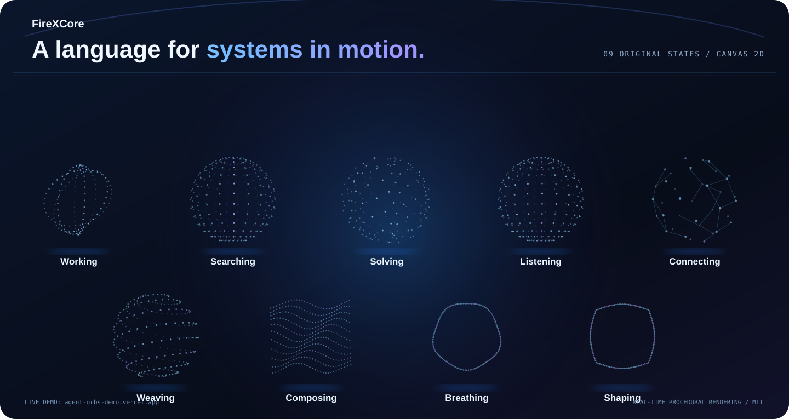
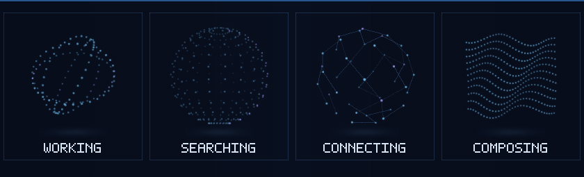
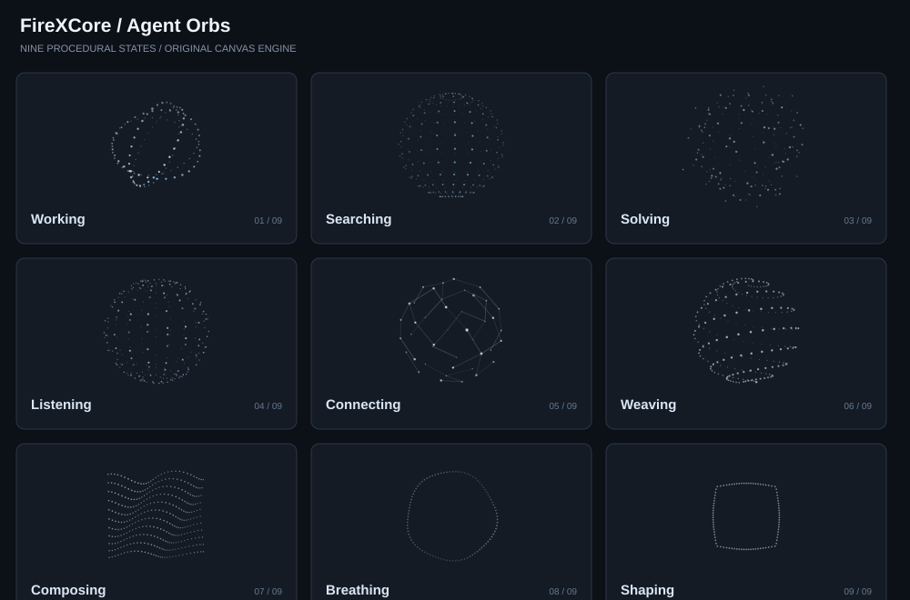

# FireXCore Agent Orbs

[](https://agent-orbs-demo.vercel.app/) [](LICENSE) [](https://github.com/FireXCore/agent-orbs/releases/tag/v0.1.0) [](https://github.com/FireXCore/agent-orbs/actions/workflows/ci.yml)

**[Interactive live demo](https://agent-orbs-demo.vercel.app/)** · [Release v0.1.0](https://github.com/FireXCore/agent-orbs/releases/tag/v0.1.0) · [Source repository](https://github.com/FireXCore/agent-orbs) · [Changelog](CHANGELOG.md)


FireXCore provides nine independently authored procedural orb states for React + TypeScript. Version 0.2 additionally includes an **optional, MIT-licensed adaptation** of the Schoolees thinking-orbs engine with a separate renderer. The original nine-state implementation remains independent and unchanged.

<p align="center">
  <a href="https://agent-orbs-demo.vercel.app/">
    
  </a>
</p>

<p align="center">
  <a href="https://agent-orbs-demo.vercel.app/"><strong>Explore the live interactive demo</strong></a>
  &nbsp;·&nbsp;
  <a href="https://agent-orbs-demo.vercel.app/#interactive">Pointer-reactive contours</a>
  &nbsp;·&nbsp;
  <a href="https://agent-orbs-demo.vercel.app/#integration">Integration playground</a>
</p>

### Motion preview — generated from the real scene engine

<p align="center">
  <a href="https://agent-orbs-demo.vercel.app/#gallery">
    
  </a>
</p>

The GIF is rendered from the original `buildScene` implementation, not a marketing simulation: `node scripts/render-motion-frames.mjs` generates scene frames; a GitHub workflow encodes them with FFmpeg. The above SVG is an illustrative vector overview; the site contains real-time Canvas previews.

**Live controls:** original/contour engines, dark/light theme, 0.5–2× speed, classic/contour treatment, pause/resume, pointer distortion and copyable integration snippets.

<details>
<summary>View the compact original nine-state contact sheet</summary>



</details>

## Features

- Nine states: `working`, `searching`, `solving`, `listening`, `connecting`, `weaving`, `composing`, `breathing`, `shaping`.
- True procedural 3D coordinate rotation and depth sorting, painted on a **Canvas 2D** surface (no WebGL, video, GIF or animation dependency).
- Small (24 px) and regular (76 px) geometry presets; arbitrary custom diameter (12–256 px).
- Single shared animation clock and per-instance offscreen pause.
- Respects `prefers-reduced-motion`; pauses when browser tab is hidden.
- Automatic dark/light mode, including `[data-theme]`, Tailwind `.dark` / `.light`, and operating-system preference.
- Optional monochrome ink and accent color, speed and pause controls.
- Accessible `AgentOrbLabel` combines a compact animation with `role="status"` text.
- React 18+ peer dependency, SSR-compatible static import, ESM/CJS/types build, strict TypeScript.

## Optional contour and interactive family (v0.2 source)

This opt-in engine adds features absent from the original FireXCore engine: `idle` and `responding` states, `classic` and `contour` modes for nine states, native `32/64/96/128px` presets, pointer/touch distortion with spring-back, an imperative DOM controller and a `<thinking-orb>` custom element. The original `AgentOrb` API and animation states are preserved.

```tsx
import { InteractiveOrb } from '@firexcore/agent-orbs';

<InteractiveOrb state="responding" variant="contour" size={96} interactive />
<InteractiveOrb state="idle" variant="classic" size={32} paused />
```

```ts
import { createThinkingOrb } from '@firexcore/agent-orbs';
const orb = createThinkingOrb('#status', { state: 'idle', variant: 'contour', interactive: true });
orb.setState('responding');
orb.pause();
orb.resume();
orb.destroy();
```

For a framework-free custom element, import `@firexcore/agent-orbs/register` once in a browser entrypoint, then use `<thinking-orb state="idle" variant="contour" size="64" interactive></thinking-orb>`.

**Attribution:** The optional implementation is adapted from [Schoolees/thinking-orbs](https://github.com/Schoolees/thinking-orbs), itself adapted from [Jakub Antalik's thinking-orbs](https://github.com/Jakubantalik/thinking-orbs). Copyright and MIT license are retained at `third_party/thinking-orbs/LICENSE` and `third_party/thinking-orbs/NOTICE.md`. These upstream animations are not presented as FireXCore-original geometry. The v0.1.0 release/package does not include this new family until a new package release is published.

## Showcase assets

- `assets/showcase.svg` — high-contrast README visual overview (vector artwork).
- `assets/motion-preview.gif` — sampled live engine animation (generated by the `render-motion-media` workflow).
- `scripts/render-motion-frames.mjs` — deterministic renderer used to generate GIF source frames.
- `preview/index.html`, `preview/styles.css`, `preview/preview.js` — source of the live Vercel showcase (not prerecorded graphics).

## Mono Lattice — classic monochrome family

The visual gallery has **three separately named families** across **two rendering engines**:

| Gallery family | Renderer | Visual treatment |
| --- | --- | --- |
| **Original** | Independent FireXCore Canvas 2D engine | Colorful, softly luminous particles |
| **Contour family** | MIT-licensed Schoolees/Jakub Antalik heritage engine | Lines/contours and pointer-reactive variants |
| **Mono Lattice** | Same MIT-licensed heritage engine, *classic* mode | Neutral grayscale halftone dots, no glow, native density presets |

**Mono Lattice** intentionally reproduces the upstream [Thinking Orbs monochrome gallery](https://schoolees.github.io/thinking-orbs/): all nine states at **128, 96, 64 and 32px**, each rendered natively, not resized from a single large orb. It uses the upstream \`variant="classic"\`, \`resolvePreset(state, size)\`, and \`ThinkingOrb\` controller already retained in the repository. This is not a third independent engine and its mathematics are not claimed as original FireXCore work.

\`\`\`tsx
import { MonoLatticeOrb } from '@firexcore/agent-orbs';

// Distinct, named component: always renders the classic monochrome dots.
<MonoLatticeOrb state="listening" size={128} theme="dark" interactive />
<MonoLatticeOrb state="listening" size={96} theme="dark" interactive />
<MonoLatticeOrb state="listening" size={64} theme="dark" interactive />
<MonoLatticeOrb state="listening" size={32} theme="dark" interactive />
\`\`\`

The four-size showcase is available in the [Mono Lattice gallery tab](https://agent-orbs-demo.vercel.app/#gallery). The original FireXCore orbs and the interactive contour gallery remain available as separate tabs. License and origin notices: [third_party/thinking-orbs/LICENSE](third_party/thinking-orbs/LICENSE) and [third_party/thinking-orbs/NOTICE.md](third_party/thinking-orbs/NOTICE.md).

## Run locally

```bash
npm install
npm run dev
```

Open http://127.0.0.1:5174/ to see the gallery and live preview.

```bash
npm run check          # typecheck, unit tests, library build, demo build
npm run build:preview  # compile standalone preview from the same original TS core
npm run test:core      # run geometry tests with Node only
```

## Standalone preview (no npm installation)

```bash
python -m http.server 5174
```

Open http://127.0.0.1:5174/preview/. The preview is generated from the exact same geometry and rendering source as the React package.

## Use in RMS (or any React application)

After publishing to npm, install `@firexcore/agent-orbs`. Until publishing, install locally:

```bash
npm install ../agent-orbs
```

```tsx
import { AgentOrb, AgentOrbLabel } from '@firexcore/agent-orbs';

export function SupplierSearch({ loading }: { loading: boolean }) {
  return loading ? (
    <AgentOrbLabel state="searching" theme="auto">Searching suppliers…</AgentOrbLabel>
  ) : null;
}

// Standalone use:
<AgentOrb state="connecting" size="regular" />
<AgentOrb state="working" size="small" color="#eef2ff" />
<AgentOrb state="solving" size={96} accent="#56b5f2" speed={0.8} />
```

Make the selected `state` reflect an actual action: for example, only display `listening` when microphone input is active, or `composing` when content is being generated. No simulated work or progress claims.

## Architecture

- `src/scenes.ts` — pure, independently authored mathematical scenes, no DOM or React.
- `src/geometry.ts` — spatial transforms, distributions and interpolation.
- `src/render.ts` — depth-sorted Canvas 2D painter.
- `src/clock.ts` — shared RAF scheduler.
- `src/appearance.ts` — theme and reduced-motion observability.
- `src/AgentOrb.tsx` — React/Canvas bridge and offscreen lifecycle.
- `src/AgentOrbLabel.tsx` — accessible status + small orb.
- `demo/` — responsive gallery with 9 large/small examples and controls.
- `tests/` — geometry, finite-frame, determinism and state coverage.
- `scripts/build-gallery-svg.mjs` — reproducible vector contact sheet of all nine states.

## Deployment

- **Live interactive demo:** https://agent-orbs-demo.vercel.app/
- **Source:** https://github.com/FireXCore/agent-orbs
- **Hosting:** Vercel, deployed from the standalone `preview/` source. The current demo is live. Static showcase updates are deployed to the existing project through the Vercel API; automatic Git-triggered deployments would require linking the repository in Vercel.

## Releases

- **Latest release:** [v0.1.0](https://github.com/FireXCore/agent-orbs/releases/tag/v0.1.0)
- **Downloadable distributable:** [firexcore-agent-orbs-0.1.0.tgz](https://github.com/FireXCore/agent-orbs/releases/download/v0.1.0/firexcore-agent-orbs-0.1.0.tgz)
- **Changelog:** [CHANGELOG.md](CHANGELOG.md)
- **Interactive demo:** [agent-orbs-demo.vercel.app](https://agent-orbs-demo.vercel.app/)

The tarball is attached to the GitHub Release. The library is also published as **`@firexcore/agent-orbs@0.1.0`** on the [GitHub Packages npm registry](https://npm.pkg.github.com/) (not npmjs.org). GitHub Packages requires authenticated npm access; new packages default to private visibility until changed in GitHub package settings.

To install with GitHub Packages authorization already configured:

```bash
npm config set @firexcore:registry https://npm.pkg.github.com
npm install @firexcore/agent-orbs@0.1.0
```

See [GitHub's npm registry authentication guide](https://docs.github.com/en/packages/working-with-a-github-packages-registry/working-with-the-npm-registry).

## Attribution

Design direction: general-purpose particle motion for AI and operations interfaces. The original nine FireXCore motion states and their rendering equations were independently authored. The optional v0.2 contour engine is adapted from Schoolees/thinking-orbs with attribution and separate MIT notices as documented above.

## License

MIT © 2026 FireXCore.
